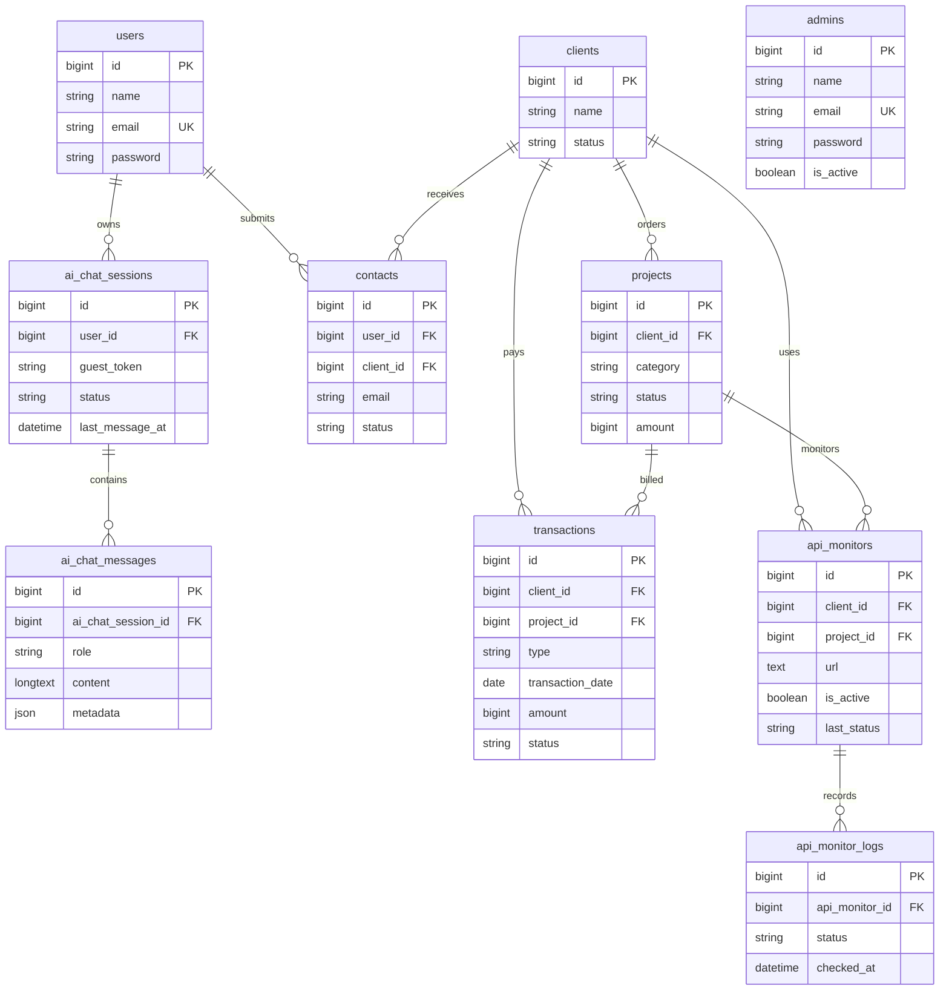

# データベース設計

対象は Laravel 12 / MySQL 8.0。金額はすべて整数円で保存し、表示・計算時の浮動小数点誤差を避ける。

## 認証

- `users`: 会員専用。既定の `web` ガードで認証する。
- `admins`: 管理者専用。`admin` ガードと独立したEloquentプロバイダーで認証する。
- 会員と管理者のセッション、パスワード再設定トークンを混在させない。

## ER図

## AI相談

- `ai_chat_sessions.user_id`: 会員相談の所有者。会員削除時は `NULL` に変更し、履歴を保持する。
- `ai_chat_sessions.guest_token`: 未登録相談を識別するランダムトークン。DB上に個人情報を保持しない。
- 運用上、セッションは `user_id` または `guest_token` の少なくとも一方を必ず持つ。ゲストが会員登録・ログインした場合は `guest_token` を維持したまま `user_id` を設定して引き継ぐ。
- `ai_chat_messages` はセッション削除時に連鎖削除する。

## 顧客・案件・会計

- `contacts`: 公開お問い合わせ。ログイン済みの場合は `user_id`、顧客化した後は `client_id` を任意で関連付ける。会員・顧客の削除後も問い合わせ履歴は保持する。
- `clients`: 顧客情報。
- `projects`: 顧客に必ず属する開発・保守案件。
- `transactions`: 売上または経費。金額と税額は1円単位の整数、家事按分は `business_ratio` に事業割合（0-100）を保存する。
- 顧客・案件を削除しても既存の売上・経費履歴を残すため、取引の外部キーは削除時 `NULL` とする。プロジェクトを持つ顧客は削除できない。

## API監視

- `api_monitors`: 顧客または案件に任意で関連付けた監視対象。
- `api_monitor_logs`: 各チェック結果。監視対象削除時は連鎖削除する。
- 実行スケジュール（毎日0時・12時）はDBではなくLaravel Schedulerで定義する。

## 状態値

状態・区分は将来の拡張を容易にするためDBの `ENUM` ではなく文字列で保存する。アプリケーションのバリデーションで以下に限定する。

| テーブル | 列 | 値 |
| --- | --- | --- |
| ai_chat_sessions | status | `open`, `closed` |
| ai_chat_messages | role | `system`, `user`, `assistant` |
| contacts | status | `new`, `in_progress`, `completed` |
| clients | status | `active`, `inactive` |
| projects | category | `development`, `maintenance` |
| projects | status | `planning`, `in_progress`, `completed`, `on_hold`, `cancelled` |
| transactions | type | `revenue`, `expense` |
| transactions | status | `unpaid`, `paid`, `cancelled` |
| api_monitors | last_status | `success`, `failure` |
| api_monitor_logs | status | `success`, `failure` |

## インデックス

- 一覧・検索で使う状態、日付、メールアドレス、ゲストトークンはインデックスを設定する。
- 会員別のAI相談、問い合わせ状態別の作成順、顧客別の案件状態、種別別の取引日、監視対象別の確認日時には複合インデックスを設定する。
- `metadata` など、検索条件にしない大きな本文やJSONはインデックス対象にしない。

## 削除・金額・日時

- 監視ログとチャットメッセージは親レコード削除時に連鎖削除する。
- 参照履歴を必要とする顧客・案件は、取引や問い合わせとの整合を優先して削除時の挙動を分ける。
- 金額は浮動小数点を避け、符号なし整数の円単位で保存する。
- 日時はLaravel標準のUTC連携を前提とし、表示時に日本時間へ変換する。
